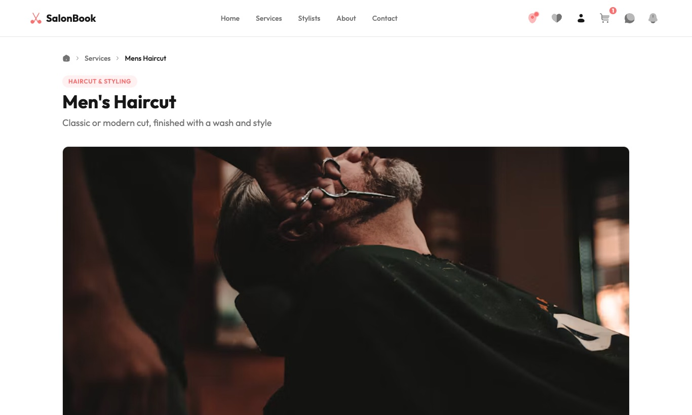
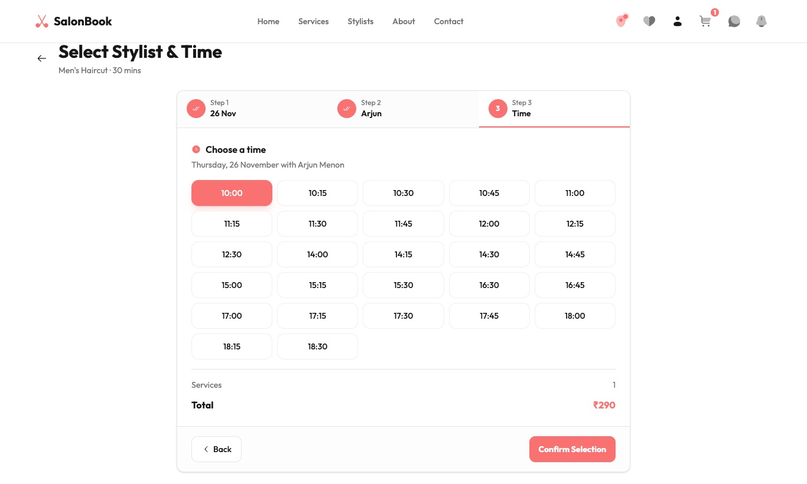
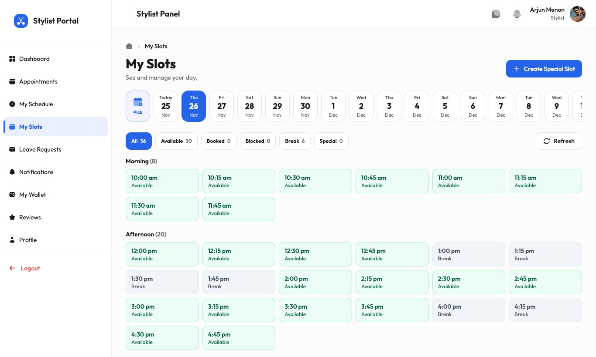
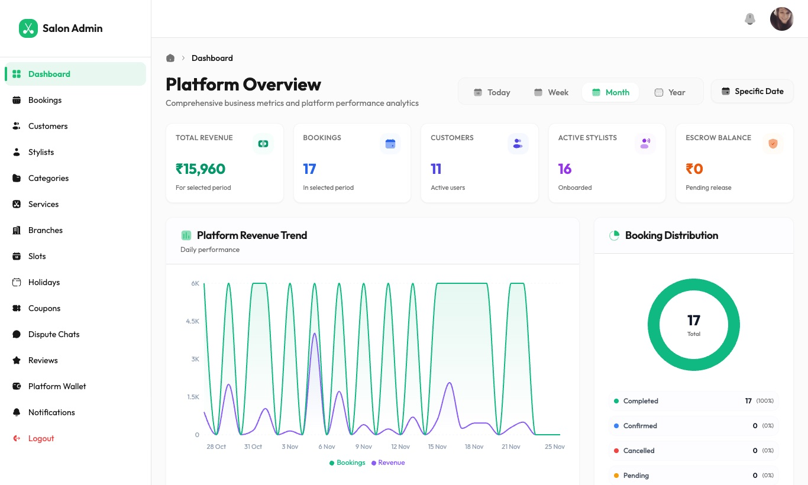
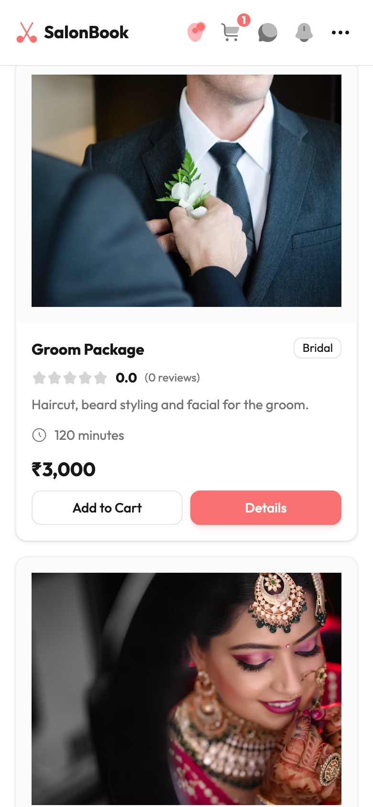

# SalonBook

**Book salon services online: pick a branch, choose your stylist and grab a free time slot.**

SalonBook is a full-stack salon booking platform with three apps in one: a customer site for booking and paying,
a stylist portal for managing the day, and an admin panel for running the business.

**Live:** [www.salonbook.online](https://www.salonbook.online)


---

## Screenshots

| Services | Service page |
|---|---|
|  |  |
| **Pick a date, stylist and time** | **Stylist: day board** |
|  |  |
| **Admin dashboard** | **On a phone** |
|  |  |

---

## Features

### Customers
- Find a branch (nearest first, using location), then browse services by category or search.
- Service pages with photos, what's included, prices, stylists and reviews.
- Stylist profiles with ratings, reviews and favourites.
- Cart with several services; choose **date → stylist → time** in three simple steps.
- Live availability: only free slots are shown, and the chosen slot is held for 15 minutes while you pay.
- Pay a **20% advance** with Razorpay (UPI, cards) or the SalonBook wallet; apply coupons at checkout.
- Pay the remaining 80% online later, or at the salon.
- Reschedule once (up to 24 hours before), cancel with a refund to the wallet, and review after the visit.
- Real-time chat with the stylist: text, photos (with camera) and voice notes.
- In-app notifications, wallet top-ups and a full booking history.
- Sign up with email or phone (OTP) or Google.

### Stylists
- Dashboard with earnings, bookings and status charts for any period.
- Appointments: mark as completed or no-show, or cancel.
- Weekly schedule, breaks, one-off day changes and leave requests.
- Day board of slots up to 90 days ahead: block or unblock times and add special slots.
- Wallet showing available balance, money held in escrow and lifetime earnings.
- Chat with customers, reviews and profile.

### Admin
- Platform dashboard: revenue, bookings, customers, stylists and escrow.
- Branches (with map location), categories and services (card and page photos, what's included).
- Per-branch prices and availability for every service.
- Stylists: invite by link, assign branch and services, approve leave.
- Bookings: view, reschedule, complete, mark no-show or cancel.
- Slots, salon holidays, coupons, reviews, dispute chats, platform wallet and notifications.

Every screen works on phones, tablets and laptops.

---

## Tech stack

| Layer | Tools |
|---|---|
| Frontend | React 19, Vite 7, TypeScript, Tailwind CSS 3, Radix UI / shadcn, Redux Toolkit, React Hook Form + Zod, Recharts, Framer Motion |
| Backend | Node.js 20, Express 5, TypeScript, Mongoose, Zod, tsyringe (dependency injection), Winston, node-cron |
| Real-time | Socket.IO (chat, notifications) |
| Data | MongoDB Atlas, Upstash Redis (OTPs, cache, sessions) |
| Services | Razorpay (payments), Cloudinary (images), SMTP (email), Twilio (SMS), Google sign-in |
| Hosting | Vercel (frontend), Render with Docker (backend) |
| Quality | ESLint, Prettier, Husky + commitlint, GitHub Actions CI |

---

## Architecture

```
Browser ──► www.salonbook.online (Vercel, static React build)
   │
   │  HTTPS (cookies)  +  WebSocket (Socket.IO)
   ▼
API on Render (Express) ── api.salonbook.online ──► MongoDB Atlas  (data)
                                                ──► Upstash Redis  (OTPs, cache, sessions)
                                                ──► Cloudinary     (images)
                                                ──► Razorpay       (payments)
                                                ──► SMTP / Twilio  (email / SMS)
   └── scheduled jobs (node-cron) run in the same process
```

- **Backend modules** follow `routes → controller → service → repository → model`, one folder per module
  (auth, branch, service, slot, booking, payment, wallet, escrow, chat, notification, review and more).
- **Auth** uses access and refresh JWTs in httpOnly cookies, with separate customer, stylist and admin sessions.
- **Payments** take a 20% advance; the stylist's share is held in escrow and released to their wallet.

More detail: [docs/architecture.md](docs/architecture.md)

---

## Project structure

```
salonbook/
├── backend/            Express API (TypeScript)
│   └── src/
│       ├── modules/    one folder per feature (routes, controller, service, repository, dto)
│       ├── models/     Mongoose schemas
│       ├── socket/     Socket.IO chat and notifications
│       ├── common/     middleware, utils, cron jobs, dependency injection
│       └── scripts/    create-admin, seed and data migrations
├── frontend/           React app (Vite)
│   └── src/
│       ├── pages/      screens for customer, stylist, admin and auth
│       ├── features/   Redux slices and thunks per feature
│       ├── components/ shared UI
│       └── services/   API calls
├── docs/               architecture, setup guide, build plan, progress log
└── .github/workflows/  CI
```

---

## Getting started

### Requirements
- Node.js 20+
- MongoDB and Redis, either local (`docker compose up mongo redis` in `backend/`) or hosted (Atlas, Upstash)
- Accounts for Razorpay (test keys work), Cloudinary, an SMTP mailbox, Twilio and a Google OAuth client.
  The API checks these settings at start-up and stops if one is missing.

### 1. Install

```bash
git clone https://github.com/ashikidarathil/salonbook.git
cd salonbook
npm install                                     # git hooks (Husky + commitlint)
npm --prefix backend install
npm --prefix frontend install
```

### 2. Environment variables

Create `backend/.env.local` and `frontend/.env.local`. Never commit them.

**Backend**

| Variable | What it is |
|---|---|
| `MONGODB_URI` | MongoDB connection string |
| `PORT` | API port (defaults to `5001`) |
| `REDIS_URL` | Redis URL (`rediss://` for TLS) |
| `JWT_SECRET`, `ACCESS_TOKEN_SECRET`, `REFRESH_TOKEN_SECRET` | Long random strings (`openssl rand -hex 32`) |
| `ACCESS_TOKEN_EXPIRES`, `REFRESH_TOKEN_EXPIRES` | For example `15m` and `7d` |
| `FRONTEND_ORIGIN` | Allowed site URLs, comma separated (local: `http://localhost:5173`) |
| `COOKIE_DOMAIN` | Cookie domain in production, for example `.salonbook.online` |
| `RAZORPAY_KEY_ID`, `RAZORPAY_KEY_SECRET` | Razorpay keys |
| `CLOUDINARY_CLOUD_NAME`, `CLOUDINARY_API_KEY`, `CLOUDINARY_API_SECRET`, `CLOUDINARY_FOLDER` | Image uploads |
| `SMTP_HOST`, `SMTP_PORT`, `SMTP_USER`, `SMTP_PASS`, `SMTP_FROM` | Email (OTP and notifications) |
| `TWILIO_ACCOUNT_SID`, `TWILIO_AUTH_TOKEN`, `TWILIO_PHONE_NUMBER` | SMS for phone OTP |
| `GOOGLE_CLIENT_ID` | Google sign-in |

**Frontend**

| Variable | What it is |
|---|---|
| `VITE_API_BASE_URL` | API URL, for example `http://localhost:5001/api` |
| `VITE_SOCKET_URL` | Socket.IO URL (optional; defaults to the API host) |
| `VITE_GOOGLE_CLIENT_ID` | Same as the backend `GOOGLE_CLIENT_ID` |

### 3. Demo data (optional)

```bash
cd backend
ADMIN_EMAIL=admin@example.com ADMIN_PASSWORD=change-me npm run create-admin
SEED_CONFIRM=<database name> SEED_STYLIST_PASSWORD=change-me npm run seed
SEED_CONFIRM=<database name> npm run seed:reviews
```

The seed adds branches, categories, services with photos, stylists with schedules, and sample reviews.
`SEED_CONFIRM` must match the database name, so a seed can never hit the wrong database. Both seeds are safe
to run again.

### 4. Run

```bash
npm run dev:backend     # API on http://localhost:5001
npm run dev:frontend    # site on http://localhost:5173
```

Admin sign-in is at `/admin/login` and stylist sign-in at `/stylist/login`.

---

## Scripts

| Where | Command | Does |
|---|---|---|
| root | `npm run dev:backend` / `npm run dev:frontend` | Start the API / the site |
| root | `npm run lint` / `npm run build` | Lint or build both apps |
| backend | `npm run create-admin` | Create or update an admin account |
| backend | `npm run seed` / `npm run seed:reviews` | Load demo data |
| backend | `npm run migrate:slugs` / `migrate:page-photos` / `migrate:included` | One-time data updates (need `MIGRATE_CONFIRM=<database name>`) |
| backend | `npm run docker:up` | API, site, MongoDB and Redis in Docker |
| frontend | `npm run typecheck` | TypeScript check |

---

## Deployment and workflow

- **Frontend** deploys to Vercel and **backend** to Render (Docker) automatically when `main` changes.
- Every pull request runs CI (lint, typecheck and build for the changed app, plus a commit-message check) and
  gets a Vercel preview link.
- Work happens on a branch, goes through a pull request and is merged once CI passes.
- Commit messages follow [Conventional Commits](https://www.conventionalcommits.org) (`feat:`, `fix:`, `docs:` …).

Step-by-step hosting setup: [docs/setup-guide.md](docs/setup-guide.md)

---

## Documentation

- [Architecture](docs/architecture.md)
- [Setup guide](docs/setup-guide.md)
- [Build plan](docs/build-plan.md)
- [Progress log](docs/PROGRESS.md)

---

Built by [@ashikidarathil](https://github.com/ashikidarathil).
